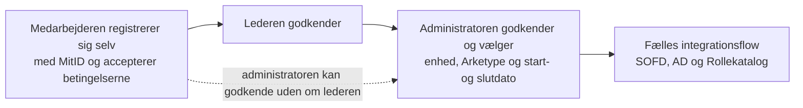
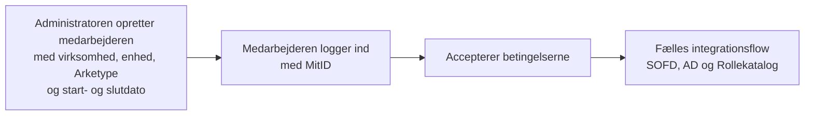
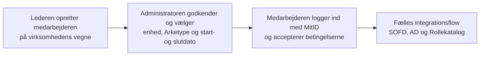

### Flow 1 — Medarbejderen registrerer sig selv

Status følger godkendelserne: *Afventer godkendelse* → *Leder har godkendt* → *Admin har godkendt +
Afventer at blive integreret*. Enten lederen eller administratoren kan afvise undervejs, og så ender
medarbejderen i status *Afvist*. Godkendte lederen ikke først, får virksomhedens ledere en mail om, at
administratoren har godkendt.

### Flow 2 — Administratoren opretter medarbejderen

Medarbejderen er godkendt fra start (*Admin har godkendt + Afventer at blive integreret*), men der sker
ingen integration ved oprettelsen. Det er accepten af betingelserne, der sætter den i gang.

### Flow 3 — Lederen opretter medarbejderen

Oprettelsen tæller som lederens egen godkendelse (*Leder har godkendt*), så medarbejderen lander direkte
på administratorens godkendelsesliste. Som i Flow 2 er det accepten af betingelserne, der sætter
integrationen i gang.