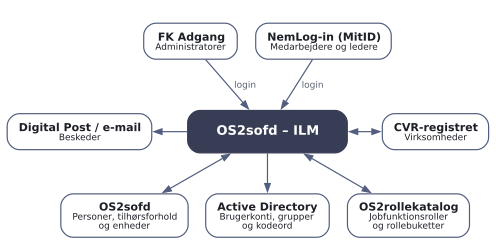
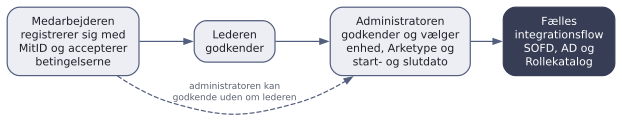
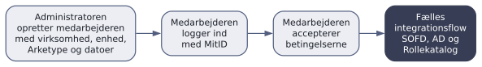
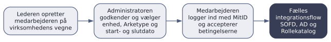
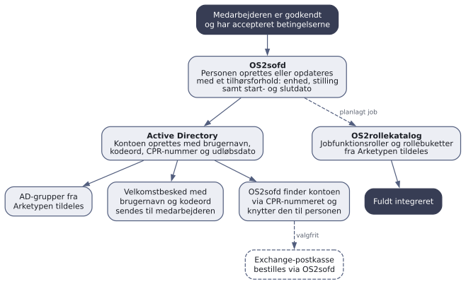
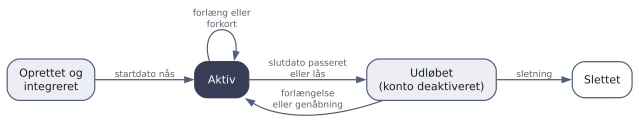

# Indledning
OS2sofd – ILM (Ikke Lønbærende Medarbejdere), i daglig tale OS2ilm, er et modul til OS2sofd. Modulet håndterer de personer, der arbejder for kommunen uden at være ansat og aflønnet af den - fx eksterne konsulenter, ansatte på selvejende institutioner og medarbejdere hos private leverandører af hjemmepleje. I løsningen kaldes de alle *medarbejdere*, og en medarbejder er altid knyttet til en *virksomhed*.

Formålet med løsningen er at understøtte en sikker, praktisk og hurtig håndtering af disse medarbejdere, så kommunen kan etablere og styre deres adgange til kommunens it-infrastruktur - fra den første anmodning, til adgangen lukkes igen.

Dokumentet henvender sig til to målgrupper:

* **Beslutningstagere**, der skal vurdere, om OS2ilm løser et behov i deres kommune.
* **Nye administratorer og brugere**, der skal have overblik over, hvad løsningen gør, og hvordan arbejdsgangene hænger sammen.

## Koblinger og afhængigheder
OS2ilm er en selvstændig webapplikation, der arbejder sammen med kommunens øvrige identitetssystemer:

* **OS2sofd** - OS2ilm henter kommunens organisation fra OS2sofd og opretter medarbejderen i OS2sofd med et tilhørsforhold, der følger medarbejderens start- og slutdato. Derfra når medarbejderen ud i de systemer, OS2sofd i forvejen forsyner.
* **Active Directory** - OS2ilm opretter brugerkontoen, aktiverer og deaktiverer den og tildeler AD-grupper.
* **OS2rollekatalog** - OS2ilm tildeler jobfunktionsroller og rollebuketter til medarbejderen.
* **NemLog-in (MitID)** - login for medarbejdere og for ledere i virksomhederne.
* **FK Adgang** - login for kommunens egne administratorer via jobfunktionsroller.
* **Digital Post og e-mail** - beskeder til medarbejdere og ledere.
* **CVR-registret** - opslag af virksomheder ud fra CVR-nummer.

# Problemet OS2ilm løser
For fastansatte er livscyklussen veldefineret: Ansættelsen registreres i lønsystemet, OS2sofd opretter personen, brugerkontoen dannes, rettighederne følger stillingen, og når ansættelsen ophører, lukkes adgangen igen.

For ikke-lønbærende medarbejdere findes den kilde ikke. Oprettelsen sker typisk via blanketter og e-mails, og det giver en række kendte problemer:

* **Manuelle processer, der tager tid** - hver oprettelse kræver, at nogen i kommunens it-afdeling indtaster oplysninger og opretter kontoen i hånden.
* **Fokus på oprettelse, ikke på nedlukning** - udløbsdatoer er svære at holde styr på, og konti lever videre, efter opgaven er slut.
* **Manglende sporbarhed** - det er svært bagefter at dokumentere, hvem der bad om adgangen, hvem der godkendte den, og hvornår.
* **Rettigheder uden standarder** - hver medarbejder får rettigheder efter et konkret skøn i stedet for efter faste profiler.
* **Genaktivering er lige så besværlig som nyoprettelse** - når en tidligere medarbejder vender tilbage, starter processen forfra.

## Det får kommunen med OS2ilm
* **Én indgang for alle ikke-lønbærende medarbejdere** - uanset om der er tale om en konsulent, en ansat på en selvejende institution eller en medarbejder hos en privat leverandør.
* **Virksomhederne gør selv en del af arbejdet** - medarbejderen registrerer sig med MitID, og lederen i virksomheden godkender. Kommunens administrator tager kun stilling til det, som kun kommunen kan afgøre: placering, rettigheder og periode.
* **Kommunen har altid det sidste ord** - der oprettes ingen konto, før en af kommunens administratorer har godkendt medarbejderen.
* **Standardiserede rettigheder** - rettigheder tildeles via *Arketyper*, der samler AD-grupper, jobfunktionsroller og rollebuketter i faste profiler.
* **Nedlukningen er besluttet fra start** - adgangen gives for en periode, og kontoen deaktiveres automatisk, når slutdatoen er passeret.
* **Samme datagrundlag som for de fastansatte** - medarbejderen oprettes i OS2sofd med et tilhørsforhold til en enhed, så lederoverblik, organisationsdata og de øvrige integrationer fra OS2sofd også omfatter de ikke-lønbærende.
* **Log-spor** - anmodning, godkendelser, oprettelse og alle senere ændringer logges med tidspunkt og aktør.
* **Mindre indtastning** - navn og CPR-nummer hentes fra MitID, og virksomhedens navn slås op i CVR-registret.

# Overordnet løsningsbeskrivelse
OS2ilm udstiller en web-portal, der anvendes af tre grupper: medarbejderne selv, deres ledere i virksomhederne og kommunens administratorer. Portalen er koblet til kommunens identitetssystemer som vist nedenfor.

{width=75%}

## Aktører og roller
| Rolle | Logger ind med | Kan |
|:---------|:----------|:------------------------------|
| **Medarbejder** | MitID (privat eller Erhverv) | Registrere sig, acceptere betingelserne, se sin profil og sit brugernavn, rette navn og telefonnummer, nulstille sit AD-kodeord og anmode om forlængelse |
| **Leder** i virksomheden | MitID Erhverv, MitID privat eller kommunens eget login | Godkende eller afvise virksomhedens medarbejdere, oprette medarbejdere på virksomhedens vegne, rette deres stamdata, låse deres konti og anmode om forlængelse |
| **Administrator** | FK Adgang (jobfunktionsrolle) | Godkende og oprette medarbejdere, håndtere deres adgange og rettigheder og opsætte hele løsningen: virksomheder, ledere, Arketyper, tekster og beskeder. Administratoren kan også sende invitationer og se log-sporet |
| **Administrator med læseadgang** | FK Adgang (jobfunktionsrolle) | Se alt, som administratoren ser, men uden at kunne ændre noget |

En leder kan kun se og håndtere medarbejdere i de virksomheder, lederen er knyttet til. Man bliver leder på en af to måder:

* **Oprettet på forhånd** - en administrator opretter lederen i OS2ilm og knytter vedkommende til en eller flere virksomheder.
* **MitID Erhverv fra virksomheden** - har kommunen slået det til, oprettes lederen automatisk første gang, vedkommende logger ind med et MitID Erhverv, der er udstedt til virksomhedens CVR-nummer.

Ledere fra kommunens egen organisation kan tilsvarende logge ind via FK Adgang med en lederrolle. Den afgørende kontrol ligger fortsat i administratorens godkendelse.

# Arbejdsgange
## Oprettelse af en medarbejder
Der er tre veje til at få oprettet en medarbejder. De adskiller sig kun i, hvem der opretter og godkender, og i hvornår integrationen sættes i gang. Derefter kører de alle det samme integrationsflow (se afsnittet *Det fælles integrationsflow*).

Fælles for alle tre veje er to regler:

* En af kommunens administratorer skal altid have godkendt medarbejderen.
* Medarbejderen skal have accepteret kommunens betingelser (vilkår og privatlivspolitik), før der oprettes noget i kommunens systemer.

Virksomheden skal være oprettet i OS2ilm på forhånd. Medarbejdere og ledere knyttes til virksomheden via dens CVR-nummer.

### Flow 1 - Medarbejderen registrerer sig selv

Medarbejderen logger ind med MitID og udfylder en registreringsformular. Navn og CPR-nummer hentes fra MitID, og medarbejderen angiver virksomhedens CVR-nummer, e-mail, stilling og eventuelt telefonnummer og en begrundelse for anmodningen. Kommunen kan vælge, at telefonnummer og begrundelse skal være påkrævet, og at navnet fra MitID ikke kan rettes. Har virksomheden ledergodkendelse slået til, angiver medarbejderen også sin leders e-mailadresse, og lederen får en mail om at godkende. Betingelserne accepteres som en del af formularen.

Status følger godkendelserne: *Afventer godkendelse* → *Leder har godkendt* → *Admin har godkendt*. Både lederen og administratoren kan afvise undervejs, og så ender medarbejderen i status *Afvist*. Administratoren kan også godkende uden om lederen. I så fald får virksomhedens ledere en mail om, at administratoren har godkendt.

> [!tip] Hvornår bruges Flow 1?
> Det er standardforløbet for nye medarbejdere. Medarbejderen kender selv sine oplysninger bedst, og arbejdet fordeles mellem medarbejder, leder og administrator.

### Invitation via e-mail
Administratoren kan invitere en medarbejder direkte fra OS2ilm ved at angive navn og e-mailadresse. Medarbejderen får en e-mail med et link til en landingsside, hvor kommunen selv har formuleret en velkomst og en vejledning. Herfra logger medarbejderen ind med MitID og fortsætter i Flow 1. Invitationen er en genvej ind i Flow 1: Den giver ikke medarbejderen nogen adgang i sig selv, og den skal stadig godkendes på normal vis.

### Flow 2 - Administratoren opretter medarbejderen

Administratoren opretter medarbejderen med virksomhed, CPR-nummer, enhed, Arketype og start- og slutdato. Medarbejderen er godkendt fra start (*Admin har godkendt*) og får en besked om at logge ind og acceptere betingelserne. Der sker ingen integration ved selve oprettelsen. Det er accepten af betingelserne, der sætter den i gang.

> [!tip] Hvornår bruges Flow 2?
> Når kommunen kender medarbejderen på forhånd - fx i hastesager eller for enkeltmandsvirksomheder, hvor et godkendelsesforløb i virksomheden er overflødigt.

### Flow 3 - Lederen opretter medarbejderen

Lederen opretter medarbejderen på virksomhedens vegne. Oprettelsen tæller som lederens egen godkendelse (*Leder har godkendt*), så medarbejderen lander direkte på administratorens godkendelsesliste. Medarbejderen får samtidig en besked om at logge ind og acceptere betingelserne. Som i Flow 2 er det accepten af betingelserne, der sætter integrationen i gang.

> [!tip] Hvornår bruges Flow 3?
> Når lederen koordinerer onboardingen af flere medarbejdere på en gang.

## Administratorens godkendelse
Godkendelsen er stedet, hvor kommunen tager stilling til det, som kun kommunen kan afgøre. Administratoren vælger:

* **Godkend eller afvis**
* **Start- og slutdato** for medarbejderens adgang. Virksomheden kan have regler for, hvor langt ude i fremtiden startdatoen må ligge, og hvor lang perioden højst må være.
* **Arketype** - blandt de Arketyper, der er gjort tilgængelige for virksomheden. Arketypen giver medarbejderen sine AD-grupper, jobfunktionsroller og rollebuketter.
* **Enhed** - hvor i kommunens organisation medarbejderen placeres. Enheden vælges i et organisationstræ fra OS2sofd og er forudfyldt med virksomhedens standardenhed.
* **Brugernavn** - kun hvis virksomheden er sat op til, at administratoren selv angiver brugernavnet.
* **Mailkonto** - om der skal bestilles en Exchange-postkasse til medarbejderen.

## Det fælles integrationsflow
Når medarbejderen er godkendt og har accepteret betingelserne, sker resten automatisk.

1. **OS2sofd** - personen findes via CPR-nummeret eller oprettes, hvis den ikke findes i forvejen. Personen får et tilhørsforhold til den valgte enhed med stilling og start- og slutdato. Er personen allerede kendt i OS2sofd, fx fordi vedkommende også er ansat i kommunen, tilføjes blot tilhørsforholdet fra OS2ilm.
2. **Active Directory** - brugerkontoen oprettes med brugernavn, kodeord, CPR-nummer og en udløbsdato, der svarer til slutdatoen. Kontoen tildeles AD-grupperne fra Arketypen.
3. **Velkomstbesked** - medarbejderen får en besked, der som standard indeholder brugernavn og kodeord.
4. **OS2sofd kobler kontoen på personen** - OS2sofd finder AD-kontoen via CPR-nummeret, og OS2ilm knytter den til tilhørsforholdet. Er der valgt en mailkonto, bestilles den via OS2sofd, når kontoen er aktiv.
5. **OS2rollekatalog** - et planlagt job tildeler medarbejderen jobfunktionsroller og rollebuketter fra Arketypen. Herefter har medarbejderen status *Fuldt integreret*.

Kontoen oprettes, så snart medarbejderen er godkendt, og OS2ilm aktiverer den, når startdatoen er nået. Hver integration kører via en kø med automatiske genforsøg, så et kortvarigt udfald hos et af systemerne ikke kræver manuel indgriben. Fejler oprettelsen af AD-kontoen, kan administratoren se det i medarbejderoversigten og prøve igen - om nødvendigt med et andet brugernavn.

Integrationen tager udgangspunkt i medarbejderens CPR-nummer, som hentes automatisk, når medarbejderen logger ind med MitID privat.

## Livscyklus og løbende administration
Efter oprettelsen følger kontoen medarbejderens periode.

| Handling | Hvem | Hvad sker der |
|:---------|:----------|:------------------------------|
| **Forlæng eller forkort** | Administrator | Ny slutdato. Kontoens udløbsdato og tilhørsforholdet i OS2sofd opdateres, og medarbejderen får besked |
| **Anmod om forlængelse** | Medarbejder og leder | Medarbejderen anmoder fra sin profil, og lederen fra medarbejderoversigten. Anmodningen havner på administratorens godkendelsesliste og i den daglige påmindelse |
| **Lås** | Administrator og leder | Slutdatoen sættes til dags dato, så kontoen udløber. Medarbejderen får besked |
| **Genåbn** | Administrator | En låst eller udløbet konto genåbnes med en ny slutdato. Medarbejderen får besked |
| **Nulstil kodeord** | Administrator og medarbejder | Et nyt kodeord sættes på kontoen og sendes til medarbejderen. Medarbejderen kan selv nulstille fra sin profil |
| **Redigér** | Administrator og leder | Administratoren kan tilpasse stamdata, periode, AD-grupper, jobfunktionsroller og rollebuketter for den enkelte medarbejder. Lederen kan kun rette stamdata |
| **Slet** | Administrator | AD-kontoen slettes, tilhørsforholdet i OS2sofd afsluttes, og medarbejderens CPR-nummer fjernes fra OS2ilm |

### Offboarding
Offboardingen er besluttet allerede ved oprettelsen, fordi adgangen altid gives for en periode. Når slutdatoen er passeret:

* **Active Directory** - kontoen er udløbet og deaktiveres af OS2ilm, så medarbejderen ikke længere kan logge på kommunens systemer med den.
* **OS2sofd** - tilhørsforholdet har samme slutdato, så OS2sofd og de systemer, OS2sofd forsyner, ser, at medarbejderen er stoppet.

Skal medarbejderen tilbage, forlænges eller genåbnes den eksisterende konto. Der skal ikke oprettes en ny.

# Opsætning og centrale begreber
## Virksomheder
En virksomhed oprettes af administratoren med navn og CVR-nummer, og navnet kan slås op i CVR-registret. CVR-nummeret er virksomhedens unikke nøgle: Det er via CVR-nummeret, at medarbejdere og ledere knyttes til virksomheden. Hver virksomhed har sine egne indstillinger:

| Indstilling | Betydning |
|:-------------|:------------------------------------|
| **Præfiks** | Kort forkortelse af virksomheden, der indgår i brugernavnene |
| **Brugernavne** | Hvordan brugernavne dannes for virksomhedens medarbejdere (se nedenfor) |
| **Standardenhed** | Den enhed, der foreslås, når en medarbejder godkendes |
| **Valgbare Arketyper** | Hvilke Arketyper der kan tildeles virksomhedens medarbejdere |
| **Ledergodkendelse** | Om virksomheden har ledere, der godkender. Er den slået til, angiver medarbejderen sin leders e-mail ved registreringen, og lederne får den daglige påmindelse |
| **Nedarvning af rettigheder** | Om medarbejderen skal arve de rettigheder, der er knyttet til enheden, eller kun have dem, der tildeles via OS2ilm |
| **Periode** | Hvor langt ude i fremtiden startdatoen må ligge, den maksimale varighed og den varighed, der foreslås |
| **Mailkonto** | Om der som standard bestilles en Exchange-postkasse til nye medarbejdere |

## Arketyper
En Arketype er en rettighedsprofil. Den samler de AD-grupper, jobfunktionsroller og rollebuketter, som en bestemt type medarbejder skal have - fx en SSA-profil med adgang til omsorgssystemet og de tilhørende AD-grupper.

* AD-grupperne hentes fra kommunens Active Directory.
* Jobfunktionsroller og rollebuketter hentes fra OS2rollekatalog.
* Arketypen kopieres over på medarbejderen ved godkendelsen. Senere ændringer af Arketypen slår derfor ikke igennem på medarbejdere, der allerede er oprettet.
* Rettighederne kan efterfølgende tilpasses for den enkelte medarbejder.

Ønsker kommunen ikke at standardisere rettighederne, kan en Arketype også blot bruges som udgangspunkt, der tilpasses fra medarbejder til medarbejder.

## Brugernavne
Hver virksomhed er sat op med en strategi for, hvordan brugernavnene dannes:

| Strategi | Brugernavnet dannes | Eksempel |
|:------------|:-------------------------|:-----------|
| **Præfiks og løbenummer** (standard) | Af kommunens faste mønster, virksomhedens præfiks og et løbenummer | `ILM-DI-0001` |
| **Skabelon** | Af en skabelon med fx for- og efternavn, initialer, virksomhedens navn eller initialer og et løbenummer | `DI-MPO-0001` |
| **OS2sofd** | Af OS2sofd efter kommunens egne regler for brugernavne | - |
| **Manuelt** | Af administratoren ved godkendelsen | - |

Et brugernavn kan højst være 20 tegn langt, og OS2ilm afviser tegn, som Active Directory ikke tillader.

## Betingelser, tekster og beskeder
Administratoren vedligeholder selv alle tekster i løsningen: betingelserne, som medarbejderne skal acceptere, landingssiden til invitationer, hjælpetekster og kommunens logo. Den samme redigering gælder beskederne til medarbejdere og ledere. Beskederne kan indeholde flettefelter som modtagerens navn, brugernavn, kodeord og dato, og hver besked kan slås til og fra. Kommunen bestemmer dermed selv, om fx kodeordet skal fremgå af beskeden.

Beskeder til medarbejdere sendes som Digital Post, når CPR-nummeret er kendt, og ellers som e-mail. Beskeder til ledere og invitationer sendes som e-mail.

| Besked | Modtager | Sendes når |
|:-----------|:------------|:---------------------------|
| Invitation | Den inviterede | Administratoren sender en invitation |
| Anmodning om godkendelse | Lederen | En medarbejder har registreret sig og angivet lederens e-mail |
| Ny adgang | Medarbejderen | Administratoren eller lederen har oprettet medarbejderen. Beskeden minder om, at betingelserne skal accepteres |
| Godkendt af administrator | Virksomhedens ledere | Administratoren har godkendt en medarbejder, som lederen ikke havde godkendt |
| Anmodning godkendt | Medarbejderen | AD-kontoen er oprettet. Beskeden indeholder som standard brugernavn og kodeord |
| Kodeord nulstillet | Medarbejderen | Kodeordet er nulstillet. Beskeden indeholder som standard det nye kodeord |
| Adgang forlænget | Medarbejderen | Slutdatoen er ændret |
| Adgang lukket | Medarbejderen | Kontoen er låst |
| Adgang genåbnet | Medarbejderen | Kontoen er genåbnet |
| Påmindelse | Ledere eller kommunens fælles postkasse | Dagligt kl. 8, når der er medarbejdere, der afventer godkendelse eller forlængelse |

## Medarbejderens selvbetjening
Medarbejderen kan altid logge ind i OS2ilm med MitID og se sin profil med brugernavn og periode. Herfra kan medarbejderen:

* **Nulstille sit AD-kodeord** - det nye kodeord sendes til medarbejderen. Har kommunen sin egen løsning til skift af kodeord, kan OS2ilm i stedet henvise til den.
* **Anmode om forlængelse** - anmodningen skal godkendes af kommunen.
* **Rette navn og telefonnummer**

## Log-spor
Alle udførende handlinger i løsningen logges: registreringer, godkendelser og afvisninger, oprettelser, ændringer, forlængelser, låsninger, nulstillinger af kodeord og sletninger. Også ændringer af virksomheder, ledere, Arketyper og tekster logges, ligesom de handlinger, systemet selv udfører, fx oprettelsen af AD-kontoen. Almindelige læsehandlinger logges ikke.

Hver hændelse gemmes med tidspunkt, aktør, målobjekt og detaljer, og hændelser fra samme session kan ses samlet. Loggen er tilgængelig for administratorer, også dem med læseadgang.

## Sletning af persondata
OS2ilm sletter automatisk medarbejdere, der ikke har været logget ind i løsningen i 13 måneder. Perioden kan konfigureres. Når administratoren sletter en medarbejder manuelt, slettes AD-kontoen, tilhørsforholdet i OS2sofd afsluttes, og CPR-nummeret fjernes fra OS2ilm.

# Teknisk overblik
OS2ilm er en webapplikation bygget på Java og Spring Boot med en MariaDB-database, og den leveres som container-image.

## Login
| Brugergruppe | Login |
|:-------------|:------------------------------------|
| Kommunens administratorer | FK Adgang (KOMBIT) med jobfunktionsroller for administrator og administrator med læseadgang |
| Medarbejdere | NemLog-in med MitID privat eller MitID Erhverv |
| Ledere i virksomhederne | NemLog-in med MitID Erhverv eller MitID privat, eller FK Adgang med en lederrolle |

## Integrationer
| System | Retning | Indhold | Hyppighed |
|:---------|:-----|:-----------------------|:------------|
| OS2sofd | Læser | Kommunens enheder | Hver time |
| OS2sofd | Skriver | Personer og tilhørsforhold, bestilling af mailkonti | Straks, via kø |
| Active Directory | Skriver | Konti, kodeord og gruppemedlemskaber | Straks, via kø |
| Active Directory | Skriver | Aktivering ved startdato og deaktivering efter slutdato | Flere gange i timen, primært i dagtimerne |
| Active Directory | Læser | AD-grupper under en konfigureret rodgruppe | Hver time |
| OS2rollekatalog | Læser | It-systemer, jobfunktionsroller og rollebuketter | Hvert 15. minut |
| OS2rollekatalog | Skriver | Tildeling af roller og rollebuketter | Hvert 15. minut |
| Digital Post | Skriver | Beskeder til medarbejdere | Straks, via kø |
| CVR-registret | Læser | Virksomhedsnavn ud fra CVR-nummer | Ved opslag |

Integrationen til Active Directory sker via Digital Identitys AD-agent - en Windows-service på kommunens netværk, som forbinder sig ud til løsningen via en websocket. CPR-nummeret skrives på kontoen i en konfigurerbar AD-attribut, så OS2sofd kan genkende kontoen.

OS2ilm har desuden et API, beskyttet med API-nøgler, til udtræk af medarbejdere og virksomheder og til at hente antallet af medarbejdere, der afventer godkendelse.

## Forudsætninger
* OS2sofd
* Tilslutning til NemLog-in for MitID-login
* Jobfunktionsroller til OS2ilm i FK Adgang
* Digital Identitys AD-agent installeret på kommunens netværk
* OS2rollekatalog, hvis rettigheder skal tildeles via Arketyper
* Digital Post til beskeder til medarbejderne

# Kom godt i gang
En typisk opstart følger denne rækkefølge:

1. **Tildel administratorroller** i FK Adgang til de medarbejdere i kommunen, der skal administrere løsningen.
2. **Tilpas tekster** - upload kommunens logo, og tilpas betingelserne, beskederne og landingssiden til invitationer.
3. **Opret Arketyper** for de typer medarbejdere, kommunen typisk har.
4. **Opret virksomhederne** med CVR-nummer, præfiks, standardenhed, valgbare Arketyper og regler for periode og brugernavne.
5. **Opret lederne** i de virksomheder, der skal godkende deres egne medarbejdere.
6. **Inviter medarbejderne** via e-mail, eller henvis dem til at registrere sig selv.
